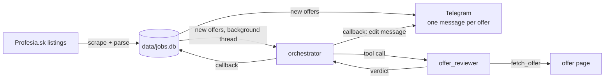

# Profesia Job Monitor

A CLI daemon that watches [Profesia.sk](https://www.profesia.sk) for new job offers matching your searches. It stores every offer in a deduplicated SQLite database, sends each new offer to Telegram subscribers, and has an LLM agent judge the offer against your backstory: 🟢 GO, 🟡 STRETCH or 🔴 SKIP.

It needs no browser. Profesia listing pages are server-rendered HTML, so scraping runs on `requests` + BeautifulSoup.

- [Getting started](#getting-started): local run and Docker
- [Configuration](#configuration)
- [How it works](#how-it-works)
- [Troubleshooting](#troubleshooting)
- [Development](#development)

## Key features

- **Multi-search monitoring**: several keyword + filter combinations, all stored in one database
- **Rich filtering**: region, remote mode, minimum salary, recency, position type, language
- **Structured salary parsing**: min/max, currency and period from Slovak labels such as `Od 3 900 EUR/mesiac`
- **Telegram notifications**: one message per new offer; users subscribe with `/start` and leave with `/stop`
- **AI verdicts**: an `orchestrator` agent hands each new offer to an `offer_reviewer` subagent, which reads the posting and rates it against your backstory. The verdict is saved and added to the offer's Telegram message as an expandable report.
- **SQLite store**: offers keyed by UUID4, unique by Profesia offer ID, with `first_seen` / `last_seen` tracking
- **Docker**: the monitor plus a sqlite-web viewer for browsing the database
- **Offline tests**: HTML fixtures and a scripted fake LLM; no network or API key needed

## Technology stack

| Area | Technology |
|---|---|
| Language | Python 3.10+ (developed on 3.13) |
| Scraping | `requests` ≥ 2.31, `beautifulsoup4` ≥ 4.12 |
| Storage | SQLite (Python's built-in `sqlite3`) |
| AI agents | `langchain` ≥ 1.0 (`create_agent`, LangGraph under the hood), `langchain-google-genai` ≥ 4.0 by default; `langchain-anthropic` or `langchain-openai` optional |
| Notifications | Telegram Bot API, long polling (no webhook or public server) |
| Containers | Docker + Docker Compose, [sqlite-web](https://github.com/coleifer/sqlite-web) viewer |
| Tests | `pytest` ≥ 8, `jsonschema` ≥ 4.20 |

## Getting started

### Prerequisites

| Needed for | What |
|---|---|
| Everything | Python 3.10+ and Git, or Docker with Compose v2.24+ |
| Telegram messages (optional) | A bot token from [@BotFather](https://t.me/BotFather) |
| AI verdicts (optional) | An API key for Google Gemini (default), Anthropic or OpenAI, plus a `backstory.md` describing your experience |

Without a bot token the monitor only prints new offers. Without an API key or backstory it runs with verdicts turned off.

### The `data/` folder

Every runtime file lives in `data/`. It's git-ignored, and Docker mounts it as `/data`, so local runs and the container share the same files:

```
data/
├── config.example.json  template for config.json                    (in the repo)
├── config.json          your searches, bot token, model settings    (you create this)
├── backstory.md         your experience, read by the offer reviewer (you create this, optional)
├── jobs.db              offer database                              (created on first run)
└── subscribers.json     Telegram subscribers                        (created on first run)
```

### Option A: run locally

**1. Install**

```powershell
# Windows (PowerShell)
git clone https://github.com/hopeless-soul/Profesia-job-monitor.git
cd Profesia-job-monitor
python -m venv .venv
.venv\Scripts\Activate.ps1
pip install -r requirements.txt
```

```bash
# macOS / Linux
git clone https://github.com/hopeless-soul/Profesia-job-monitor.git
cd Profesia-job-monitor
python -m venv .venv
source .venv/bin/activate
pip install -r requirements.txt
```

For the Anthropic or OpenAI provider, also run `pip install langchain-anthropic` or `pip install langchain-openai`.

**2. Create the config**

```bash
cp data/config.example.json data/config.json      # PowerShell: Copy-Item data\config.example.json data\config.json
```

Open `data/config.json` (VS Code autocompletes it from the schema) and:

- edit `searches` (see [Search filters](#search-filters))
- set `telegram.token` to your bot token, or leave it `null` and use `TELEGRAM_BOT_TOKEN`
- set `model.api_key`, or leave it `null` and use the provider's env var

API keys can also come from the environment:

```powershell
$env:TELEGRAM_BOT_TOKEN = "123456:ABC..."
$env:GOOGLE_API_KEY = "..."        # or ANTHROPIC_API_KEY / OPENAI_API_KEY
```

**3. Add your backstory (for verdicts)**

Save your experience as markdown in `data/backstory.md`: roles, stack, projects, years. The offer reviewer judges fit only from what this file says.

**4. Import old offers (only when upgrading from a `jobs.json` version)**

```bash
python -m profesia_monitor --import-json jobs.json
```

Do this **before the first run**. Otherwise every offer already in your archive is sent to subscribers as new. Imported offers keep their timestamps and get no verdicts. Running it twice is safe.

**5. Test run without Telegram**

```bash
python -m profesia_monitor --once --no-notify -v
```

Expected output:

```
'c#' bratislavsky-kraj: 20 offers
'python' informacne-technologie plny-uvazok: 40 offers
NEW 5381969  Go Developer/Engineer | AT&T Global Network Services Slovakia | 3 100 - 4 700 EUR/mesiac
Scraped 60, new 1, total 359 in data\jobs.db
INFO verdict SKIP for offer 5381969 (uuid 05185bf4-...)
```

If you see `WARNING verdicts disabled: …`, check [Troubleshooting](#troubleshooting).

**6. Start monitoring**

```bash
python -m profesia_monitor
```

```
Running: scraping every 60 min, 1 Telegram subscriber(s), verdicts on. Ctrl+C to stop.
```

It scrapes now and then every `interval` minutes. Send `/start` to your bot in Telegram to subscribe. Ctrl+C stops it.

On Windows you can double-click **`run-monitor.bat`** instead. It runs the same thing **locally** with the `.venv` Python (`python -m profesia_monitor -v`); it does **not** start Docker. Before starting, it checks that:

- `.venv` exists (otherwise it prints the install commands)
- `data\config.json` exists (otherwise it tells you to copy `data\config.example.json`)
- the Docker `monitor` container isn't running (otherwise it asks you to run `docker compose stop monitor`, since both would send every offer twice)

To run in the background on Windows:

```powershell
Start-Process .venv\Scripts\pythonw.exe `
  -ArgumentList "-m profesia_monitor --log monitor.log" `
  -WorkingDirectory $PWD
```

### Option B: run with Docker

**1. Prepare `data/`** as in steps 2–4 above (config, backstory, optional import). The import can also run inside the container:

```bash
cp jobs.json data/
docker compose run --rm --no-deps monitor python -m profesia_monitor -c /data/config.json --import-json /data/jobs.json
```

**2. Secrets (optional).** Copy `.env.example` to `.env` and fill in `TELEGRAM_BOT_TOKEN` and `GOOGLE_API_KEY`, unless they're already in `data/config.json`.

**3. Start**

```bash
docker compose up -d --build
```

This is the only way to start the Docker version; `run-monitor.bat` always runs locally.

| Service | What it does |
|---|---|
| `monitor` | Runs `python -m profesia_monitor -c /data/config.json -v`, restarting unless stopped |
| `viewer` | sqlite-web at http://localhost:8080 for browsing `jobs.db`. It listens on localhost only and **can edit** the database. |

Everyday commands:

```bash
docker compose logs -f monitor        # follow output
docker compose stop monitor           # pause monitoring
docker compose down                   # stop everything
docker compose run --rm --no-deps monitor python -m profesia_monitor -c /data/config.json --once -v   # single run
```

> **Run either locally or in Docker, not both.** They share `data/`, so running both would scrape and notify every offer twice.

## Configuration

`data/config.json` is read by default; `-c FILE` picks another file. Relative paths in it resolve against the config's folder. The full schema is in [`schemas/config.schema.json`](schemas/config.schema.json), and [`data/config.example.json`](data/config.example.json) is a starting point.

```json
{
  "$schema": "../schemas/config.schema.json",
  "db": "jobs.db",
  "backstory": "backstory.md",
  "pages": 3,
  "delay": 1.5,
  "interval": 60,
  "count_days": 7,
  "searches": [
    { "keyword": "c#", "segments": ["bratislavsky-kraj"], "remote_work": 2, "min_salary": 2000 },
    { "keyword": "python", "segments": ["informacne-technologie", "plny-uvazok"] }
  ],
  "telegram": { "token": null, "subscribers": "subscribers.json" },
  "model": { "provider": "google", "name": "gemini-2.5-flash", "temperature": 0.0, "max_tokens": 8192, "api_key": null }
}
```

| Key | Default | Meaning |
|---|---|---|
| `db` | `jobs.db` | SQLite database |
| `backstory` | `backstory.md` | Your experience, for the offer reviewer |
| `pages` | `3` | Max listing pages per search (20 offers per page) |
| `delay` | `1.5` | Seconds between page requests |
| `interval` | `60` | Minutes between scrapes |
| `count_days` | `null` | Only offers from the last N days; a search's own `count_days` overrides it |
| `searches` | required | List of searches (below) |
| `telegram.token` | `null` | Bot token; `null` falls back to `TELEGRAM_BOT_TOKEN` |
| `telegram.subscribers` | `subscribers.json` | Subscriber list |
| `model.provider` | `anthropic` | `google`, `anthropic` or `openai` |
| `model.name` | `null` | `null` uses the default: `gemini-2.5-flash`, `claude-sonnet-4-5`, `gpt-4o-mini` |
| `model.temperature` | `0.0` | 0 gives the most consistent verdicts |
| `model.max_tokens` | `8192` | Keep it high: thinking models spend part of it on reasoning, and around 1024 the verdict gets cut off |
| `model.api_key` | `null` | `null` falls back to `GOOGLE_API_KEY` / `ANTHROPIC_API_KEY` / `OPENAI_API_KEY` |

### Search filters

| Key | Values | Meaning |
|---|---|---|
| `keyword` | free text | Searches the offer text (required) |
| `segments` | path slugs | Region, position, employment type, work area, language |
| `remote_work` | `0` / `1` / `2` / `null` | On-site only / remote only / partially remote / any |
| `min_salary` | integer | Minimum salary in EUR |
| `salary_period` | `"m"` / `"h"` | Monthly or hourly (used with `min_salary`) |
| `count_days` | integer | Only offers from the last N days |

Common segments:

| Filter | Examples |
|---|---|
| Region | `bratislavsky-kraj`, `zilinsky-kraj`, `kosicky-kraj`, `zahranicie` |
| Position | `programator-programatorka`, `dotnet-programator-programatorka` |
| Employment | `plny-uvazok`, `skrateny-uvazok`, `na-dohodu-brigady`, `zivnost` |
| Work area | `informacne-technologie`, `elektrotechnika-a-energetika` |
| Language | `anglicky-jazyk`, `nemecky-jazyk` |

### CLI options

| Option | Meaning |
|---|---|
| `KEYWORD` | One-off search that ignores the config's searches, e.g. `python -m profesia_monitor "c#" --remote 2 --once` |
| `--segment SLUG`, `--remote N`, `--min-salary N`, `--salary-period m\|h` | Filters for a one-off `KEYWORD` search |
| `--once` | Scrape once, wait for verdicts, exit |
| `--interval MINUTES` | Minutes between scrapes |
| `-c FILE` | Config file (default `data/config.json`) |
| `--db FILE` | Database file |
| `--days N` | Only offers from the last N days, for every search |
| `--pages N` | Max listing pages per search |
| `--delay SECONDS` | Seconds between page requests |
| `--import-json FILE` | Import an old `jobs.json` into the database, then exit |
| `--no-notify` | Don't send Telegram messages |
| `--log FILE` | Append all output to FILE |
| `-v` | Verbose logging, including verdict lines |

## How it works



1. **Scrape.** Every `interval` minutes, each search's listing pages are fetched and parsed.
2. **Store.** Offers are upserted by Profesia ID. Known offers get refreshed fields and `last_seen`; new ones get a UUID.
3. **Notify.** Each new offer goes to every subscriber as its own message, about one per second per chat. The message IDs are saved.
4. **Review.** In a background thread, the `orchestrator` agent receives the offer URL and calls the `offer_reviewer` subagent. The reviewer fetches the posting, rates every must-have against your backstory (✅ / 🟡 / ❌), and returns `{tag, content, url}`.
5. **Callback.** The verdict is saved, each subscriber's message is edited to add the tag and an expandable report, and `verdict <tag> for offer <id> (uuid …)` is logged.

A review costs about 4 LLM calls. Scraping and `/start` replies never wait on it.

### Database

| Table | Contents |
|---|---|
| `offers` | `uuid` (primary key), Profesia `id` (unique), scraped fields, `salary` / `labels` as JSON, `first_seen`, `last_seen`, `verdict_tag`, `verdict_content` (full report), `verdict_url` |
| `offer_messages` | The Telegram message each chat got for an offer: `offer_uuid`, `chat_id`, `message_id` |

### Agents

The agents' instructions are markdown files in [`profesia_monitor/agents/prompts/`](profesia_monitor/agents/prompts/): `orchestrator.md`, `offer_reviewer.md` (steps, rating thresholds, report format) and `offer_research.md` (how far to research). Edit them to change how offers are judged. The reviewer's prompt is these files plus your `backstory.md`.

To add a subagent, create `agents/<name>.py` with `build_<name>(llm)` and an `as_tool` wrapper, write `prompts/<name>.md`, and add the tool to the orchestrator in `agents/orchestrator.py`.

## Project structure

```
profesia_monitor/
├── __main__.py           CLI, main loop, verdict callback
├── config.py             Config loading and validation
├── scraper.py            HTTP fetching, Query builder, pagination
├── parser.py             HTML parsing (no network)
├── models.py             Dataclasses: Job, Salary, Verdict
├── store.py              SQLite store and legacy jobs.json import
├── telegram.py           Bot API client, subscribers, message formatting
└── agents/
    ├── llm.py            Chat model from the config's `model` section
    ├── tools.py          fetch_offer tool
    ├── orchestrator.py   Main agent; evaluate(url) -> Verdict
    ├── offer_reviewer.py Subagent and its wrapper as an orchestrator tool
    └── prompts/          Agent instructions (markdown)
schemas/                  JSON Schema for config.json
tests/                    pytest suite and HTML fixtures
Dockerfile, docker-compose.yml, .env.example
run-monitor.bat           Windows launcher for a local run
```

Design notes:

- **No browser engine.** Listing pages are server-rendered, so `requests` is enough.
- **Offer ID as the dedup key.** The original fork deduplicated by `(title, company)`, which merged reposts and missed renames. The numeric ID in `/O<id>` URLs is stable.
- **Per-chat message table.** Every subscriber gets a different `message_id`, so verdict edits look up each chat's own message.
- **Safe writes.** Each scrape is one SQLite transaction. `subscribers.json` is written via `tempfile` → `os.replace`, so a crash never truncates it.

## Troubleshooting

| Symptom | Fix |
|---|---|
| `data/config.json not found` | Do [step 2](#option-a-run-locally), or pass `-c FILE` |
| `config: unknown keys ['out']` | Your config predates SQLite: rename `"out": "jobs.json"` to `"db": "jobs.db"` |
| `verdicts disabled: …` | The message names the cause: the provider package isn't installed, the API key is missing, or `backstory.md` isn't at the `backstory` path |
| `verdict failed for offer …` with a JSON / structured output error | The answer was cut off; raise `model.max_tokens` (8192 works for Gemini 2.5+) |
| Verdict tag `UNREACHABLE` | The reviewer couldn't read the offer page (expired, login wall, JS-only) |
| `Telegram rejected the bot token` | Wrong `telegram.token` / `TELEGRAM_BOT_TOKEN` |
| Every old offer arrived in Telegram as new | `--import-json` wasn't run before the first run |
| Offers arrive twice | The local monitor and the Docker `monitor` are both running |

## Development

```bash
pip install -r requirements-dev.txt
python -m pytest
```

Tests run offline against HTML fixtures in `tests/fixtures/` and a scripted fake chat model:

| Test file | Covers |
|---|---|
| `test_parser.py` | Card parsing, salary extraction, edge cases |
| `test_scraper.py` | Query URLs, pagination |
| `test_store.py` | SQLite upsert, deduplication, legacy JSON import |
| `test_config.py` | Config validation, path resolution, error messages |
| `test_telegram.py` | Bot commands, subscribers, per-offer messages, verdict formatting |
| `test_agents.py` | Orchestrator → offer_reviewer delegation, structured verdicts, prompts |
| `test_main.py` | Verdict callback: save, message edits, failure handling |

### Conventions

- `master` is the main branch; features go in their own branches (e.g. `AI-integration`) and merge back.
- Every function, step and larger block gets a short `#` comment above it. Use `#` comments, not docstrings; only `__main__.py` keeps a module docstring as CLI help.
- Type hints everywhere, with `from __future__ import annotations`; dataclasses for data.
- Input is validated at the edges (`config.py`, CLI flags); internal code trusts it.
- New behavior comes with a test that runs offline.
