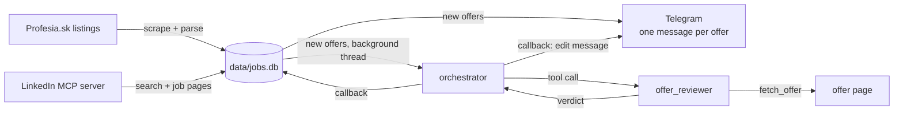

# Profesia Job Monitor

A CLI daemon that watches [Profesia.sk](https://www.profesia.sk), and optionally LinkedIn, for new job offers matching your searches. It stores every offer in a deduplicated SQLite database, sends each new offer to Telegram subscribers, and has an LLM agent judge the offer against your backstory: 🟢 GO, 🟡 STRETCH or 🔴 SKIP.

Profesia needs no browser: its listing pages are server-rendered HTML, so scraping runs on `requests` + BeautifulSoup. The optional [LinkedIn source](#linkedin-source) runs through the LinkedIn MCP server, which drives a browser logged in as you.

- [Getting started](#getting-started): local run and Docker
- [Configuration](#configuration)
- [How it works](#how-it-works)
- [Troubleshooting](#troubleshooting)
- [Development](#development)

## Key features

- **Multi-search monitoring**: several keyword + filter combinations, all stored in one database
- **Rich filtering**: region, remote mode, minimum salary, recency, position type, language
- **Structured salary parsing**: min/max, currency and period from Slovak labels such as `Od 3 900 EUR/mesiac`
- **LinkedIn source (optional)**: recent LinkedIn jobs go through the same store, Telegram messages and verdicts
- **Cross-source duplicates**: a new offer with the same title + company as a stored one (any source) is stored but not sent or reviewed again
- **Telegram notifications**: one message per new offer; users subscribe with `/start` and leave with `/stop`
- **AI verdicts**: an `orchestrator` agent hands each new offer to an `offer_reviewer` subagent, which reads the posting and rates it against your backstory. The verdict is saved and added to the offer's Telegram message as an expandable report.
- **SQLite store**: offers keyed by UUID4, unique by `(source, id)`, with `first_seen` / `last_seen` tracking
- **Docker**: the monitor plus a sqlite-web viewer for browsing the database
- **Offline tests**: HTML fixtures and a scripted fake LLM; no network or API key needed

## Technology stack

| Area | Technology |
|---|---|
| Language | Python 3.10+ (developed on 3.13) |
| Scraping | `requests` ≥ 2.31, `beautifulsoup4` ≥ 4.12 |
| Storage | SQLite (Python's built-in `sqlite3`) |
| AI agents | `langchain` ≥ 1.0 (`create_agent`, LangGraph under the hood), `langchain-google-genai` ≥ 4.0 by default; `langchain-anthropic` or `langchain-openai` optional |
| LinkedIn (optional) | `mcp` ≥ 2.0 client for [`mcp-server-linkedin`](https://github.com/stickerdaniel/linkedin-mcp-server), started with `uvx` |
| Notifications | Telegram Bot API, long polling (no webhook or public server) |
| Containers | Docker + Docker Compose, [sqlite-web](https://github.com/coleifer/sqlite-web) viewer |
| Tests | `pytest` ≥ 8 |

## Getting started

### Prerequisites

| Needed for | What |
|---|---|
| Everything | Python 3.10+ and Git, or Docker with Compose v2.24+ |
| Telegram messages (optional) | A bot token from [@BotFather](https://t.me/BotFather) |
| AI verdicts (optional) | An API key for Google Gemini (default), Anthropic or OpenAI, plus a `backstory.md` describing your experience |

Without a bot token the monitor only prints new offers. Without an API key or backstory it runs with verdicts turned off.

### The `data/` folder

Every runtime file lives in `data/`. It's git-ignored, and Docker mounts it as `/app/data`, so local runs and the container share the same files:

```
data/
├── configs/
│   ├── config.yaml                shared settings: bot token, model       (you create this)
│   ├── profesia_sk.example.yaml   template for Profesia.sk searches       (in the repo)
│   ├── profesia_sk.yaml           Profesia.sk searches and retries        (you create this, optional)
│   ├── linkedin.example.yaml      template for LinkedIn searches          (in the repo)
│   └── linkedin.yaml              LinkedIn searches and retries           (you create this, optional)
├── agent_context/
│   ├── backstory.md               your experience, read by the offer reviewer (you create this, optional)
│   └── projects/*.md              pet-project write-ups, added to the backstory (you create these, optional)
├── jobs.db                        offer database                          (created on first run)
└── subscribers.json               Telegram subscribers                    (created on first run)
```

### Option A: run locally

**1. Install**

```powershell
# Windows (PowerShell)
git clone https://github.com/hopeless-soul/Profesia-job-monitor.git
cd Profesia-job-monitor
python -m venv .venv
.venv\Scripts\Activate.ps1
pip install -r requirements.txt
```

```bash
# macOS / Linux
git clone https://github.com/hopeless-soul/Profesia-job-monitor.git
cd Profesia-job-monitor
python -m venv .venv
source .venv/bin/activate
pip install -r requirements.txt
```

For the Anthropic or OpenAI provider, also run `pip install langchain-anthropic` or `pip install langchain-openai`.

**2. Create the config**

```bash
cp data/configs/config.example.yaml data/configs/config.yaml      # PowerShell: Copy-Item data\configs\config.example.yaml data\configs\config.yaml
```

Copy the provider examples you want, then edit them:

```bash
cp data/configs/profesia_sk.example.yaml data/configs/profesia_sk.yaml   # Profesia.sk searches
cp data/configs/linkedin.example.yaml data/configs/linkedin.yaml         # LinkedIn searches (optional)
```

- in `config.yaml`, list the sources to run in `providers`, e.g. `[profesia]` or `[profesia, linkedin]`
- in `profesia_sk.yaml`, edit `searches` (see [Search filters](#search-filters))
- set `telegram.token` in `config.yaml` to your bot token, or leave it `null` and use `TELEGRAM_BOT_TOKEN`
- set `model.api_key`, or leave it `null` and use the provider's env var

API keys can also come from the environment:

```powershell
$env:TELEGRAM_BOT_TOKEN = "123456:ABC..."
$env:GOOGLE_API_KEY = "..."        # or ANTHROPIC_API_KEY / OPENAI_API_KEY
```

**3. Add your backstory (for verdicts)**

Save your experience as markdown in `data/agent_context/backstory.md`: roles, stack, projects, years. The offer reviewer judges fit only from what this file says.

Optionally, put one markdown file per pet project in `data/agent_context/projects/` (the `projects` folder next to `backstory.md`). Every `*.md` there is appended to the backstory under a `## Pet project: <file name>` header, and the reviewer counts it as evidence, marked as a personal project.

**4. Test run without Telegram**

```bash
python -m offer_monitor --once --no-notify -v
```

Expected output:

```
'c#' bratislavsky-kraj: 20 offers
'python' informacne-technologie plny-uvazok: 40 offers
NEW 5381969  Go Developer/Engineer | AT&T Global Network Services Slovakia | 3 100 - 4 700 EUR/mesiac
Scraped 60, new 1, total 359 in data\jobs.db
INFO verdict SKIP for offer 5381969 (uuid 05185bf4-...)
```

If you see `WARNING verdicts disabled: …`, check [Troubleshooting](#troubleshooting).

**5. Start monitoring**

```bash
python -m offer_monitor
```

```
Running: scraping every 60 min, 1 Telegram subscriber(s), verdicts on. Ctrl+C to stop.
```

It scrapes now and then every `interval` minutes. Send `/start` to your bot in Telegram to subscribe. Ctrl+C stops it.

On Windows you can double-click **`run-monitor.bat`** instead. It runs the same thing **locally** with the `.venv` Python (`python -m offer_monitor -v`); it does **not** start Docker. Before starting, it checks that:

- `.venv` exists (otherwise it prints the install commands)
- `data\configs\config.yaml` exists (otherwise it tells you to copy `data\configs\config.example.yaml`)
- the Docker `monitor` container isn't running (otherwise it asks you to run `docker compose stop monitor`, since both would send every offer twice)

To run in the background on Windows:

```powershell
Start-Process .venv\Scripts\pythonw.exe `
  -ArgumentList "-m offer_monitor --log monitor.log" `
  -WorkingDirectory $PWD
```

### Option B: run with Docker

**1. Prepare `data/`** as in steps 2–3 above (config, backstory).

**2. Secrets (optional).** Put the bot token and API key in `data/configs/config.yaml` (`telegram.token`, `model.api_key`). If they're `null` there, the monitor reads `TELEGRAM_BOT_TOKEN` and the provider's variable (e.g. `GOOGLE_API_KEY`) from the environment.

**3. Start**

```bash
docker compose up -d --build
```

This is the only way to start the Docker version; `run-monitor.bat` always runs locally.

| Service | What it does |
|---|---|
| `monitor` | Runs `python -m offer_monitor -v`, restarting unless stopped |
| `viewer` | sqlite-web at http://localhost:8080 for browsing `jobs.db`. It listens on localhost only and **can edit** the database. |

Everyday commands:

```bash
docker compose logs -f monitor        # follow output
docker compose stop monitor           # pause monitoring
docker compose down                   # stop everything
docker compose run --rm --no-deps monitor python -m offer_monitor --once -v   # single run
```

> **Run either locally or in Docker, not both.** They share `data/`, so running both would scrape and notify every offer twice.

## Configuration

`data/configs/config.yaml` holds the shared settings. Each job source has its own file in `data/configs/`, and a source is on when `providers` lists it: `profesia` reads `data/configs/profesia_sk.yaml` and `linkedin` reads `data/configs/linkedin.yaml`. A provider file that isn't listed is ignored. There is one config: the monitor always reads `data/configs/config.yaml` from the folder it runs in (the project folder, or `/app` in Docker). Relative paths resolve against that folder. The committed examples are the `*.example.yaml` files in `data/configs/`.

```yaml
providers: [profesia, linkedin]
db: ../jobs.db
backstory: ../agent_context/backstory.md
interval: 60
telegram:
  token: null
  subscribers: ../subscribers.json
model:
  provider: google
  name: gemini-2.5-flash
  temperature: 0.0
  max_tokens: 8192
  api_key: null
```

| Key | Default | Meaning |
|---|---|---|
| `providers` | required | Sources to run: `profesia`, `linkedin`. Each listed one needs its file in the same folder; `[]` runs none |
| `db` | `../jobs.db` | SQLite database (paths resolve against `data/configs/`, so `../` is `data/`) |
| `backstory` | `../agent_context/backstory.md` | Your experience, for the offer reviewer |
| `interval` | `60` | Minutes between scrapes |
| `telegram.token` | `null` | Bot token; `null` falls back to `TELEGRAM_BOT_TOKEN` |
| `telegram.subscribers` | `../subscribers.json` | Subscriber list |
| `model.provider` | `anthropic` | `google`, `anthropic` or `openai` |
| `model.name` | `null` | `null` uses the default: `gemini-2.5-flash`, `claude-sonnet-4-5`, `gpt-4o-mini` |
| `model.temperature` | `0.0` | 0 gives the most consistent verdicts |
| `model.max_tokens` | `8192` | Keep it high: thinking models spend part of it on reasoning, and around 1024 the verdict gets cut off |
| `model.api_key` | `null` | `null` falls back to `GOOGLE_API_KEY` / `ANTHROPIC_API_KEY` / `OPENAI_API_KEY` |
### Profesia.sk source

`data/configs/profesia_sk.yaml` holds the Profesia searches. It's read when `providers` lists `profesia`. Example: [`data/configs/profesia_sk.example.yaml`](data/configs/profesia_sk.example.yaml).

| Key | Default | Meaning |
|---|---|---|
| `pages` | `3` | Max listing pages per search (20 offers per page) |
| `delay` | `1.5` | Seconds between page requests |
| `count_days` | `null` | Only offers from the last N days; a search's own `count_days` overrides it |
| `retry.attempts` | `3` | Tries per run, including the first (1 to 10) |
| `retry.delay` | `30` | Seconds between tries |
| `searches` | required | List of searches (below) |

### Search filters

| Key | Values | Meaning |
|---|---|---|
| `keyword` | free text | Searches the offer text (required) |
| `segments` | path slugs | Region, position, employment type, work area, language |
| `remote_work` | `0` / `1` / `2` / `null` | On-site only / remote only / partially remote / any |
| `min_salary` | integer | Minimum salary in EUR |
| `salary_period` | `"m"` / `"h"` | Monthly or hourly (used with `min_salary`) |
| `count_days` | integer | Only offers from the last N days |

Common segments:

| Filter | Examples |
|---|---|
| Region | `bratislavsky-kraj`, `zilinsky-kraj`, `kosicky-kraj`, `zahranicie` |
| Position | `programator-programatorka`, `dotnet-programator-programatorka` |
| Employment | `plny-uvazok`, `skrateny-uvazok`, `na-dohodu-brigady`, `zivnost` |
| Work area | `informacne-technologie`, `elektrotechnika-a-energetika` |
| Language | `anglicky-jazyk`, `nemecky-jazyk` |

### LinkedIn source

With `linkedin` in `providers` and its file `data/configs/linkedin.yaml`, every run also searches LinkedIn through the [LinkedIn MCP server](https://github.com/stickerdaniel/linkedin-mcp-server). For each search it collects job IDs, skips the ones already stored, opens the rest and reads company, title, location, posted time and work type from the job page. The jobs then go through the same store, Telegram messages and verdicts as Profesia offers. Example: [`data/configs/linkedin.example.yaml`](data/configs/linkedin.example.yaml).

| Key | Default | Meaning |
|---|---|---|
| `searches[].keywords` | required | Search text. Put the location in it (`"python developer in Slovakia"`): LinkedIn ignores a separate location filter |
| `searches[].work_type` | `null` | Comma-separated `on_site`, `remote`, `hybrid` |
| `searches[].experience_level` | `null` | Comma-separated `internship`, `entry`, `associate`, `mid_senior`, `director`, `executive` |
| `searches[].job_type` | `null` | Comma-separated `full_time`, `part_time`, `contract`, `temporary`, `volunteer`, `internship`, `other` |
| `date_posted` | `past_24_hours` | `past_hour`, `past_24_hours`, `past_week` or `past_month` |
| `max_pages` | `1` | Result pages per search, 1 to 10 |
| `delay` | `1.5` | Seconds between job detail requests |
| `retry.attempts` | `3` | Tries per run, including the first (1 to 10) |
| `retry.delay` | `30` | Seconds between tries |

Setup:

1. Install [uv](https://docs.astral.sh/uv/). The monitor starts the server with `uvx mcp-server-linkedin@latest`.
2. Do the first run from a console: `python -m offer_monitor --once`. The server downloads its Chromium in the background (LinkedIn is skipped with a warning until it's ready), then opens a login window. Sign in there, including any captcha or two-factor check. The session is saved for later runs.
3. When the session expires, LinkedIn is skipped with a `linkedin skipped: …` warning and a login window opens again.

Limits:

- **Local runs only.** Login needs a visible browser window; in Docker the LinkedIn step fails each run and is skipped with a warning. Profesia keeps working.
- **Your account.** The server uses your own LinkedIn session. Keep `interval` and `max_pages` modest: frequent automated searches can get the account restricted.
- **No salary.** LinkedIn offers are stored with `salary` empty.
- The whole LinkedIn step is limited to 5 minutes per run; jobs read before the limit are kept. A job whose page fails is retried next run.

### CLI options

The options only pick how the monitor runs. Every setting (sources, searches, paging, interval, database) lives in `data/configs/`, which the monitor always reads from the project folder, whatever folder you start it from.

| Option | Meaning |
|---|---|
| `--once` | Scrape once, wait for verdicts, exit |
| `--no-notify` | Don't send Telegram messages |
| `--log FILE` | Append all output to FILE |
| `-v` | Verbose logging, including verdict lines |

## How it works



1. **Scrape.** Every `interval` minutes, each search's listing pages are fetched and parsed. With `linkedin` set, LinkedIn searches run next; only job pages not stored yet are opened.
2. **Store.** Each source first drops its own repeats (`dedup_fetched`); after all sources finish, each picks its offers not stored yet (`db_dedup`), all in one transaction. Known offers get refreshed fields and `last_seen`; new ones get a UUID. A new offer whose title + company (case and spacing ignored) matches a stored offer from any source, or an earlier one in the same scrape, is stored but skips steps 3 and 4.
3. **Notify.** Each new offer goes to every subscriber as its own message, about one per second per chat. The message IDs are saved.
4. **Review.** In a background thread, the `orchestrator` agent receives the offer URL and calls the `offer_reviewer` subagent. The reviewer fetches the posting, rates every must-have against your backstory (✅ / 🟡 / ❌), and returns `{tag, content, url}`.
5. **Callback.** The verdict is saved, each subscriber's message is edited to add the tag and an expandable report, and `verdict <tag> for offer <id> (uuid …)` is logged.

A review costs about 4 LLM calls. Scraping and `/start` replies never wait on it.

### Database

| Table | Contents |
|---|---|
| `offers` | `uuid` (primary key), `source` (`profesia` / `linkedin`) + `id` (unique together), scraped fields, `salary` / `labels` as JSON, `first_seen`, `last_seen`, `verdict_tag`, `verdict_content` (full report), `verdict_url` |
| `offer_messages` | The Telegram message each chat got for an offer: `offer_uuid`, `chat_id`, `message_id` |

### Agents

The agents' instructions are markdown files in [`offer_monitor/agents/prompts/`](offer_monitor/agents/prompts/): `orchestrator.md`, `offer_reviewer.md` (steps, rating thresholds, report format) and `offer_research.md` (how far to research). Edit them to change how offers are judged. The reviewer's prompt is these files plus your `backstory.md`.

To add a subagent, create `agents/<name>.py` with `build_<name>(llm)` and an `as_tool` wrapper, write `prompts/<name>.md`, and add the tool to the orchestrator in `agents/orchestrator.py`.

## Project structure

```
offer_monitor/
├── __main__.py           Main loop, run_once with per-source retries
├── cli.py                CLI arguments
├── globals.py            Default config path and console colors
├── config.py             Main config (config.yaml) and loading the provider files
├── errors.py             ConfigError
├── settings.py           RetryPolicy and YAML loading (shared by all configs)
├── http.py               Retry-After parsing, shared by the sources and the offer fetcher
├── models.py             Dataclasses: Job, Salary, Verdict
├── store.py              SQLite store
├── telegram.py           Bot API client, subscribers, message formatting
├── providers/
│   ├── __init__.py       Registry: build_providers(names, folder), source labels
│   ├── base.py           SourceProvider base class and SourceProviderError
│   ├── profesia_sk/      Profesia.sk source
│   │   ├── config.py     profesia_sk.yaml: searches, pages, delay, retry
│   │   ├── errors.py     typed Profesia errors, one per cause
│   │   ├── scraper.py    HTTP fetching, pagination
│   │   ├── parser.py     HTML parsing (no network)
│   │   └── provider.py   ProfesiaProvider
│   └── linkedin/         LinkedIn source via the LinkedIn MCP server
│       ├── config.py     linkedin.yaml: searches, filters, delay, retry
│       ├── errors.py     typed LinkedIn errors, one per cause
│       └── provider.py   LinkedInProvider
└── agents/
    ├── llm.py            Chat model from the config's `model` section
    ├── tools.py          fetch_offer tool
    ├── orchestrator.py   Main agent; evaluate(url) -> Verdict
    ├── offer_reviewer.py Subagent and its wrapper as an orchestrator tool
    └── prompts/          Agent instructions (markdown)
tests/                    pytest suite and HTML fixtures
Dockerfile, docker-compose.yml
run-monitor.bat           Windows launcher for a local run
```

Design notes:

- **No browser engine.** Listing pages are server-rendered, so `requests` is enough.
- **`(source, id)` as the key.** The offer ID on its site is stable, so it decides whether an offer is already stored. Title + company only decides whether a new offer is worth a message and a verdict, so the same role posted for several cities or on both sites notifies once.
- **Automatic migration.** A database created before the LinkedIn source is rebuilt once on first open: rows keep their UUIDs and verdicts and get `source = 'profesia'`.
- **Per-chat message table.** Every subscriber gets a different `message_id`, so verdict edits look up each chat's own message.
- **Safe writes.** Each scrape is one SQLite transaction. `subscribers.json` is written via `tempfile` → `os.replace`, so a crash never truncates it.

## Troubleshooting

| Symptom | Fix |
|---|---|
| `data/configs/config.yaml not found` | Do [step 2](#option-a-run-locally) |
| `config.yaml: providers: list the sources to run` | Your config predates the list: add `providers: [profesia]` (plus `linkedin` if you use it) |
| `providers lists 'linkedin', but … linkedin.yaml is missing` | Copy that provider's `*.example.yaml` next to `config.yaml`, or remove it from `providers` |
| `verdicts disabled: …` | The message names the cause: the provider package isn't installed, the API key is missing, or `backstory.md` isn't at the `backstory` path |
| `profesia skipped after N attempt(s) (ProfesiaUnavailableError)` | Profesia could not be reached in any try. Check the connection; the next run tries again |
| `profesia failed (ProfesiaBlockedError), not retrying` | Profesia refused the requests (401/403). The source is skipped this run; wait before running again |
| `profesia failed (ProfesiaRateLimitedError)` | Profesia asked to slow down; the monitor waits its Retry-After and tries again |
| `profesia failed (ProfesiaLayoutError)` | Profesia changed its listing markup, so the parser finds no offers. The parser needs an update |
| `linkedin failed (LinkedInAuthError), not retrying` | LinkedIn needs a login or a verification. Run once from a console and sign in, as in the LinkedIn section |
| `linkedin skipped after N attempt(s) (LinkedInUnavailableError)` | The LinkedIn server did not start or stopped responding. Check `uv` is installed, then run again |
| `verdict failed for offer …` with a JSON / structured output error | The answer was cut off; raise `model.max_tokens` (8192 works for Gemini 2.5+) |
| Verdict tag `UNREACHABLE` | The reviewer couldn't read the offer page (expired, login wall, JS-only, or still rate-limited after 3 retries) |
| `fetch …: HTTP 429, retrying in N s` | The site is rate-limiting page downloads; the fetch waits and retries up to 3 times |
| `linkedin skipped: … login …` | Sign in to the LinkedIn window that opened (console run), then the next run picks LinkedIn up |
| `linkedin skipped: …` with `uvx` not found | Install [uv](https://docs.astral.sh/uv/) |
| `Telegram rejected the bot token` | Wrong `telegram.token` / `TELEGRAM_BOT_TOKEN` |
| Offers arrive twice | The local monitor and the Docker `monitor` are both running |

## Development

```bash
pip install -r requirements-dev.txt
python -m pytest
```

Tests run offline against HTML fixtures in `tests/fixtures/` and a scripted fake chat model:

| Test file | Covers |
|---|---|
| `test_parser.py` | Listing parsing, layout-change detection |
| `test_scraper.py` | HTTP errors per cause, pagination, Profesia provider |
| `test_linkedin.py` | LinkedIn job parsing, MCP calls, error classes, time limit |
| `test_sources.py` | Provider registry, dedup, retry settings |
| `test_store.py` | SQLite upsert, round trip, deduplication, migration |
| `test_config.py` | Config validation, path resolution, error messages |
| `test_telegram.py` | Bot commands, subscribers, per-offer messages, verdict formatting |
| `test_agents.py` | Orchestrator → offer_reviewer delegation, structured verdicts, prompts |
| `test_tools.py` | `fetch_offer` retries and Retry-After |
| `test_main.py` | run_once across sources, retries, verdict callback |

### Conventions

- `master` is the main branch; features go in their own branches (e.g. `AI-integration`) and merge back.
- Every function, step and larger block gets a short `#` comment above it. Use `#` comments, not docstrings.
- Type hints everywhere, with `from __future__ import annotations`; dataclasses for data.
- Input is validated at the edges (`config.py`, CLI flags); internal code trusts it.
- New behavior comes with a test that runs offline.
